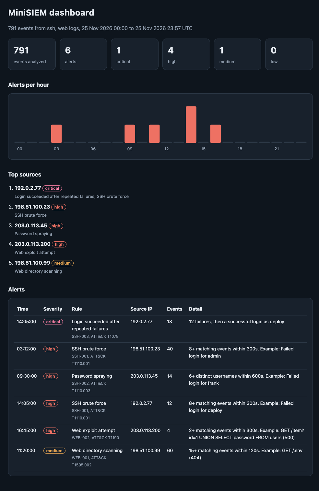

# MiniSIEM


A small Security Information and Event Management tool. It reads SSH and web server logs, normalizes them into one event format, runs detection rules mapped to MITRE ATT&CK, and produces an HTML dashboard of alerts. Pure Python, no dependencies, fully offline.

## Quick start

```bash
python3 generate_logs.py                                                    # synthetic logs with hidden attacks
python3 minisiem.py --ssh logs/auth.log --web logs/access.log -o dashboard.html
open dashboard.html
python3 -m unittest
```

The generated logs hold one day of normal traffic plus five attacks from reserved documentation IPs. See `examples/dashboard.html` for a finished dashboard.

## How it works

1. **Parse.** Each log line becomes a normalized event (time, source, IP, user, action).
2. **Detect.** Rules match events, group them by source IP, and fire when a threshold is crossed in a time window. A continuing attack extends one alert instead of spamming many.
3. **Correlate.** One rule looks across events: a successful login right after many failures.
4. **Report.** An HTML dashboard shows alerts per hour, top sources, and every alert with its ATT&CK technique.

## Detection rules

| ID | Detects | ATT&CK | Severity |
|---|---|---|---|
| SSH-001 | 8+ failed logins from one IP in 5 min | T1110.001 Password Guessing | high |
| SSH-002 | 6+ distinct usernames tried from one IP in 10 min | T1110.003 Password Spraying | high |
| SSH-003 | Successful login after 5+ failures | T1078 Valid Accounts | critical |
| WEB-001 | 15+ 404 responses to one IP in 2 min | T1595.002 Vulnerability Scanning | medium |
| WEB-002 | Traversal, SQL injection, XSS or JNDI patterns in requests | T1190 Exploit Public-Facing Application | high |

## Limitations

Thresholds are fixed and tuned on synthetic data, so real logs will need tuning. Attackers who rotate IPs would evade per-IP grouping. Only two log formats are supported.

## Ideas to extend

Windows event logs, rules in YAML, GeoIP enrichment, alert export to JSON, and correlation across web and SSH activity from the same IP.


